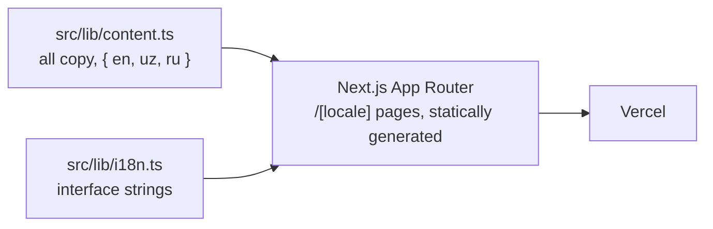

# mhaydarov-portfolio

**A personal site for Muhammad Sodik Khaydarov, a student researcher from Tashkent working where history, languages and maps meet. English, Uzbek and Russian.**

[](https://mhaydarov-portfolio.vercel.app/)
[](package.json)

**Live:** https://mhaydarov-portfolio.vercel.app/

Built by Muzaffar Khaydarov for his brother. It is a separate site from Muzaffar's own
software-engineering portfolio ([`muzaffars`](https://github.com/mountstorm/muzaffars)), with different content and a different purpose.

## What's on the site

- **One scrolling homepage** with sections for Research, Xarita, Community, Writing and Music
- **A page for the research paper**: *Measuring Before Believing: The Khwarazmian Origins of
  al-Biruni's Comparative Method*, shown as an abstract and status badge while it is under review
- **Three languages**: English at `/`, Uzbek at `/uz`, Russian at `/ru`, each with its own
  canonical URL and `hreflang` tags
- **Light and dark theme**, applied before first paint so there is no flash
- **Per-page social cards** generated at `/og/home` and `/og/research`

## Architecture



All the words on the site live in one file, so changing the text never means touching components.
Untranslated Uzbek and Russian fields fall back to English, and empty fields render a visible
"To add" slot instead of filler text, so the site never says anything its author did not write.

## Run it

Needs Node 18 or newer.

```bash
npm install
npm run dev
```

Open http://localhost:3000.

| Script | What it does |
|---|---|
| `npm run dev` | Dev server |
| `npm run build` | Production build |
| `npm run start` | Serve the production build |
| `npm run lint` | `next lint` |

Deploys to Vercel. Pushes to `main` auto-deploy once the Vercel GitHub App has access to the
repo; otherwise `npx vercel deploy --prod --yes`.

## Details worth keeping

- **Scroll reveals fail visible.** Content is opaque by default and is only hidden after the
  reveal script confirms it can show it again, with a 1.5 s failsafe. A simpler version blanked
  the live site twice.
- **Filename casing matters.** macOS ignores case and Vercel's Linux build does not, so check
  `git ls-files` before trusting a green local build.
- **Privacy by design.** Contact is an email and nothing else: no phone, address or schedule.
- **Favicon** is a crop of Vasily Perov's 1872 portrait of Dostoyevsky from Wikimedia Commons,
  in the public domain.

## Known limitations

- **Some content is still "To add".** A few sections, such as Xarita screenshots, are waiting for the author's copy.
- **Uzbek and Russian interface strings are a first pass** and want a native read-through.
- **The paper is not downloadable yet.** It is under review, so only the abstract is public.

## Credits

Written and researched by Muhammad Sodik Khaydarov. Code by
[Muzaffar Khaydarov](https://github.com/mountstorm). Set in Next.js and Tailwind CSS.
